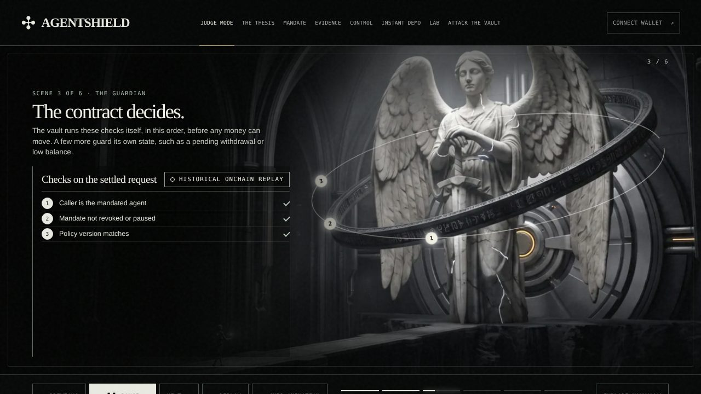
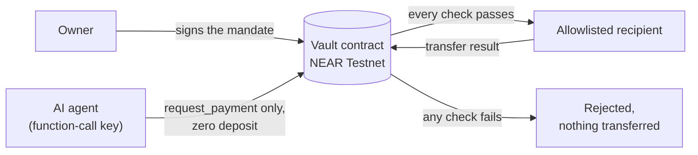

# AgentShield

[](https://github.com/0xNexuz/agentshield/actions/workflows/ci.yml)

**Spending limits for AI agents, enforced by a NEAR smart contract.**

An owner puts funds in a vault contract and signs a mandate. The mandate says which agent may ask, which accounts it may pay, how much per payment, per UTC day and in total, and until when. The agent's key can call only the vault's `request_payment` method, and the vault checks every request itself before any money moves. An agent that is fooled by a prompt injection, or is simply wrong, still cannot overspend, pay an account that isn't allowlisted, or replay a payment.

The vault is deployed on **NEAR Testnet**, not mainnet. Built for NEAR HACKATHON 2026, track AI Security & Defense.

- **Live site:** [agentshield-lab.vercel.app](https://agentshield-lab.vercel.app/) (start with [Judge mode](https://agentshield-lab.vercel.app/#judge))
- **Live proof, rechecked against public RPC on every request:** [payment](https://agentshield-lab.vercel.app/api/testnet/proof) and [rejected attacks](https://agentshield-lab.vercel.app/api/testnet/gallery)
- **The contract:** [`contracts/vault/src/lib.rs`](contracts/vault/src/lib.rs)



## Try it in 3 minutes

You don't need a wallet, an account or a key.

| Do | You should see |
| --- | --- |
| Open [/#judge](https://agentshield-lab.vercel.app/#judge) and press **Watch AgentShield in action** | A six-scene replay, about 75 seconds. Every fact is labelled `SIMULATION`, `HISTORICAL ONCHAIN REPLAY`, `LIVE RPC VERIFIED` or `NOT YET VERIFIED`, and the proof scene turns `LIVE RPC VERIFIED` once the site has rechecked Testnet. |
| Open [/api/testnet/proof](https://agentshield-lab.vercel.app/api/testnet/proof) | `"verification":"PASS"`, `"settlement":"SETTLED"`, `"codeHash":"2KHm9Waz7fQfQ2A1MWmHhVSwx7o7sm8p1KXBTVyggCqN"`, `"currentKeyStillScoped":true` |
| Open [/api/testnet/gallery](https://agentshield-lab.vercel.app/api/testnet/gallery) | Three results, each `"decision":"REJECTED"` with `"vaultTransferReceiptCount":0`: `PER_PAYMENT_LIMIT`, `RECIPIENT_NOT_ALLOWED`, `REPLAY` |
| `npm ci && npm test` | `# pass 31`, `# fail 0`. Offline, with no keys and no chain access. |
| `cargo test --manifest-path contracts/vault/Cargo.toml --locked` | `test result: ok. 12 passed` |
| Open the latest [CI run](https://github.com/0xNexuz/agentshield/actions/workflows/ci.yml), job **Rebuild the deployed WASM from source** | `MATCH`: the source rebuilds into the exact 324,708-byte WASM that is deployed |

The site also has **Attack the vault** (`#attack`): the recorded attacks with a live recheck button, custom attacks in a local simulator, and a prompt-injection challenge.

## How it works



1. The owner signs a mandate with `set_mandate`: one agent, an allowlist of recipients, per-payment, daily and total limits, and an expiry.
2. The agent holds a NEAR function-call access key that can call only `request_payment` on the vault, with no attached deposit. A stolen agent key can only ask.
3. The vault checks each request in this order: mandate exists, caller is the agent, not revoked, not paused, no owner withdrawal pending, current mandate version, request expiry, nonce format, recipient allowlisted, per-payment cap, nonce not used before, daily budget, total budget, capacity, balance. The first failure is returned as a reason such as `RECIPIENT_NOT_ALLOWED`.
4. When every check passes, the vault reserves the amount against the daily and total budgets, marks the nonce as used, and sends the transfer itself.
5. A private callback reads the transfer result and records `SETTLED` or `TRANSFER_FAILED`. A failed transfer releases the reserved budget but never frees the nonce.

Offchain, [`work/near-ai-payment-agent.mjs`](work/near-ai-payment-agent.mjs) asks NEAR AI Cloud to turn an instruction into a strict JSON proposal, then a preflight checks it against the live mandate and returns `ALLOW`, `WARN` (a human approves) or `BLOCK` (nothing is signed). The contract stays the final boundary either way. The full trust-boundary diagram is in [docs/ARCHITECTURE_AND_EVIDENCE.md](docs/ARCHITECTURE_AND_EVIDENCE.md).

## Evidence on NEAR Testnet

Vault [`vault.agentshield-mag-1d2f78801994.testnet`](https://testnet.nearblocks.io/address/vault.agentshield-mag-1d2f78801994.testnet), code hash `2KHm9Waz7fQfQ2A1MWmHhVSwx7o7sm8p1KXBTVyggCqN`. The mandate allows one agent, `agentshield-agent-0359da1630bb.testnet`, to pay one recipient, `agentshield-recipient-7bb4a0df1077.testnet`, up to 0.01 test NEAR per payment, 0.02 per UTC day and 0.05 in total. The payment and the attacks ran under version 1. On 2026-11-03 the owner renewed it as version 2 with the same rules, valid until 2026-11-30 00:00 UTC.

| Event | Transaction | Result |
| --- | --- | --- |
| Vault deployed | [`7K4729…y2dJ`](https://testnet.nearblocks.io/txns/7K4729h6zNHjuXJcGRT9e6HHGxCrUnzFAZ3AnQpfy2dJ) | Code hash `2KHm9Waz…CqN`, the SHA-256 of `deployment/agentshield_vault.wasm` |
| Agent key created | [`3faZ6…5CaP`](https://testnet.nearblocks.io/txns/3faZ6WmFDgbM8KUCRnbDLztbYSysKwNGdoq83jy95CaP) | `ed25519:3mVXz3ww…5Y6V`, limited to the vault's `request_payment` |
| Mandate signed | [`GLhrrb…xbG7`](https://testnet.nearblocks.io/txns/GLhrrbxzn93YVKhq6JAxogNW27jf19XqfkfqAJdmxbG7) | Version 1, signed by the owner |
| Mandate renewed | [`EuUUbL…vJXw`](https://testnet.nearblocks.io/txns/EuUUbLWvPUVVB2q7AiEVGe54giZaarzBy2hikX74vJXw) | Version 2, signed by the owner: same agent, recipient and limits, expiry 2026-11-30 00:00 UTC |
| Authorized payment, 0.005 test NEAR | [`3buDvB…53jm`](https://testnet.nearblocks.io/txns/3buDvBXKDHcCe9VBNtLSSp4H7LLjLfGk7K4XT2jh53jm) | `SETTLED`; recipient transfer receipt `76hE3jsBgdCi8BCBZakcwEMri9Ut7JVu2gDWf3rxK2dS` |
| Attack: over the per-payment cap | [`FEfj7K…L8A`](https://testnet.nearblocks.io/txns/FEfj7KyY5Cr7NTrhDZdXt8Hi1rQqqMwznvK1KhL1ZL8A) | `REJECTED / PER_PAYMENT_LIMIT`, no transfer |
| Attack: recipient not on the allowlist | [`GvMLEq…gDX9`](https://testnet.nearblocks.io/txns/GvMLEqPTLZfnN4cTVVBS6mKghD7LuTpXgH7ZSAQvgDX9) | `REJECTED / RECIPIENT_NOT_ALLOWED`, no transfer |
| Attack: replay of the settled payment | [`8ktDr3…yjY`](https://testnet.nearblocks.io/txns/8ktDr3AFxE8kVQP1KNkvGBY44oMWWvRCY6tXUqWyvyjY) | `REJECTED / REPLAY`, no transfer |
| Revocation | — | **Not yet shown on Testnet.** Passes in NEAR Sandbox against the deployed WASM. |

All attacks were signed with the restricted agent key and sent to the deployed vault. The committed records are in `outputs/testnet-*.json`, and the proof APIs recheck them on every request.

## Claims and where to check them

"Unit" means the Rust tests in `lib.rs`, which use a mocked runtime. "Sandbox" means [`sandbox/vault.test.mjs`](sandbox/vault.test.mjs), which runs the deployed WASM in NEAR Sandbox. CI runs both on every push.

| Rule | Code | Tests | Testnet proof |
| --- | --- | --- | --- |
| Only the mandated agent can request | [L260](contracts/vault/src/lib.rs#L260) `WRONG_AGENT` | Unit `policy_rejections_leave_budget_untouched`; Sandbox "allowlist, per-payment limit and agent identity" | — |
| The agent's key can call only `request_payment`, with zero deposit | NEAR access-key permission (protocol level) | `tests/agent-key-scope.test.mjs`; Sandbox "restricted function-call key settles only the approved vault method" | [`3faZ6…5CaP`](https://testnet.nearblocks.io/txns/3faZ6WmFDgbM8KUCRnbDLztbYSysKwNGdoq83jy95CaP) |
| A revoked or paused mandate refuses new requests | [L263](contracts/vault/src/lib.rs#L263) `REVOKED`, [L266](contracts/vault/src/lib.rs#L266) `PAUSED` | Unit `revocation_blocks_new_requests_but_pending_can_settle`; Sandbox "revocation prevents new payments after settlement", "pause, stale version and owner withdrawal" | Not yet |
| The request names the current mandate version | [L272](contracts/vault/src/lib.rs#L272) `STALE_VERSION` | Sandbox "pause, stale version and owner withdrawal" | — |
| The request hasn't expired and ends inside the mandate | [L279](contracts/vault/src/lib.rs#L279) `EXPIRED` | Sandbox "pause, stale version and owner withdrawal" | — |
| The recipient is allowlisted | [L285](contracts/vault/src/lib.rs#L285) `RECIPIENT_NOT_ALLOWED` | Unit `policy_rejections_leave_budget_untouched`; Sandbox "allowlist, per-payment limit and agent identity" | [`GvMLEq…gDX9`](https://testnet.nearblocks.io/txns/GvMLEqPTLZfnN4cTVVBS6mKghD7LuTpXgH7ZSAQvgDX9) |
| The amount is above zero and within the per-payment cap | [L289](contracts/vault/src/lib.rs#L289) `PER_PAYMENT_LIMIT` | Unit `policy_rejections_leave_budget_untouched`; Sandbox "allowlist, per-payment limit and agent identity" | [`FEfj7K…L8A`](https://testnet.nearblocks.io/txns/FEfj7KyY5Cr7NTrhDZdXt8Hi1rQqqMwznvK1KhL1ZL8A) |
| A nonce works once per mandate version, even if its transfer fails | [L293](contracts/vault/src/lib.rs#L293) `REPLAY` | Unit `valid_request_reserves_and_replay_does_not_schedule_again`, `failed_transfer_releases_budget_but_keeps_nonce`; Sandbox "funding, owner authorization, settlement and replay" | [`8ktDr3…yjY`](https://testnet.nearblocks.io/txns/8ktDr3AFxE8kVQP1KNkvGBY44oMWWvRCY6tXUqWyvyjY) |
| The daily budget counts pending payments | [L306](contracts/vault/src/lib.rs#L306) `DAILY_LIMIT` | Unit `two_pending_requests_cannot_take_last_daily_budget`; Sandbox "two agent keys cannot exceed a shared budget" | — |
| The total budget counts pending payments | [L314](contracts/vault/src/lib.rs#L314) `TOTAL_LIMIT` | Unit `total_budget_counts_pending_requests` | — |
| No payments while an owner withdrawal is pending | [L269](contracts/vault/src/lib.rs#L269) `WITHDRAWAL_PENDING` | Unit `pending_withdrawal_blocks_payment_and_failure_releases_guard`, `…_success_releases_guard`; Sandbox "pause, stale version and owner withdrawal" | — |
| Settlement is recorded only after the transfer result, exactly once | `on_transfer_result` [L381](contracts/vault/src/lib.rs#L381), `#[private]` | Unit `successful_transfer_settles_exactly_once`, `failed_transfer_releases_budget_but_keeps_nonce`; Sandbox "failed recipient transfer releases reservation without settlement" | [`3buDvB…53jm`](https://testnet.nearblocks.io/txns/3buDvBXKDHcCe9VBNtLSSp4H7LLjLfGk7K4XT2jh53jm) |
| Only the owner changes policy or funds the vault | `assert_owner` [L489](contracts/vault/src/lib.rs#L489) | Unit `non_owner_cannot_change_policy`, `initializer_must_be_owner`, `only_owner_can_fund_and_attached_amount_is_reported` | [`GLhrrb…xbG7`](https://testnet.nearblocks.io/txns/GLhrrbxzn93YVKhq6JAxogNW27jf19XqfkfqAJdmxbG7) |
| The deployed code is built from this source | [`work/reproduce-vault-wasm.ps1`](work/reproduce-vault-wasm.ps1) | CI job "Rebuild the deployed WASM from source" prints `MATCH` | [`7K4729…y2dJ`](https://testnet.nearblocks.io/txns/7K4729h6zNHjuXJcGRT9e6HHGxCrUnzFAZ3AnQpfy2dJ) |

**How the rebuild works.** The deployed WASM names its compiler in its `producers` section, `rustc 1.96.0 (ac68faa20 2026-05-25)`, and its panic strings contain the folders of the original Windows build machine. The script installs Rust 1.96.0 on a Windows runner, recreates those folders, builds `contracts/vault` and compares SHA-256 hashes. The result is `138b17e7f1a227b22352e2e638fd69e60e0ad95f7a4dd003d8cbd244f8ffbe09`, the same as the committed WASM and therefore the code hash on chain.

## What is real and what is simulated

| Part | Status |
| --- | --- |
| Vault contract, agent key, mandate, one settled payment, three refused attacks | **Real**, on NEAR Testnet (table above) |
| Deployed WASM built from this source | **Real**, rebuilt byte for byte in CI |
| Revocation | NEAR Sandbox only, against the deployed WASM. **Not yet shown on Testnet.** |
| Instant Demo and custom attacks on the site | **Simulated** in the browser (`outputs/agentshield-ui/simulator.mjs`) |
| NEAR AI proposal and ALLOW / WARN / BLOCK preflight | Implemented; the model is **mocked** in tests. **No real NEAR AI completion yet:** calls return HTTP 402 until credits are added. |
| Prompt-injection challenge on the site | The model step is **simulated**. The contract result it points to is the real `RECIPIENT_NOT_ALLOWED` rejection. |
| Owner wallet sign-in | **Not verified** end to end |
| Mainnet | **Not implemented** |

## Run it yourself

```sh
npm ci
npm test                                                         # 31 Node tests, offline
cargo test --manifest-path contracts/vault/Cargo.toml --locked   # 12 Rust unit tests
node --use-system-ca work/preview-server.js                      # the site at http://127.0.0.1:4321
```

Recheck the Testnet evidence from your own machine (read-only, needs network). The first command also rewrites `outputs/testnet-live-payment-independent-proof.json` with a fresh `checkedAt`.

```sh
node --use-system-ca work/verify-testnet-live-payment.mjs
node --use-system-ca work/verify-testnet-negative-scenarios.mjs
```

- **NEAR Sandbox tests** of the deployed WASM run on Linux or WSL2: the setup steps are in [docs/RELEASE_AND_SUBMISSION.md](docs/RELEASE_AND_SUBMISSION.md#reproduce-from-a-clone), then `bash work/run-sandbox-tests.sh`.
- **The WASM rebuild** runs on Windows with `pwsh work/reproduce-vault-wasm.ps1`. It creates folders under `C:\Users\USER\`, so use a throwaway machine or let CI run it.
- **Windows setup, the NEAR AI command line and Vercel** are covered in [LOCAL_DEVELOPMENT.md](LOCAL_DEVELOPMENT.md).

Keep TLS verification on: if your shell sets `NODE_TLS_REJECT_UNAUTHORIZED=0`, set it back to `1`. Don't run `work/execute-*.mjs` or `work/deploy-*.mjs`. They sign Testnet transactions with the owner's keys, which are not in this repository.

## Where things are

| Path | What it holds |
| --- | --- |
| `contracts/vault/src/lib.rs` | The vault contract (Rust, `near-sdk` 5.29.1) and its unit tests |
| `deployment/agentshield_vault.wasm` | The exact bytecode deployed on Testnet |
| `deployment/*.json` | Inputs for the recorded deploy, payment, rejection and renewal runs |
| `sandbox/` | NEAR Sandbox tests that run the deployed WASM |
| `tests/` | Node tests: simulator, key scope, AI preflight, API routes, proof regression and site evidence |
| `api/testnet/` | Read-only Vercel functions `proof`, `gallery`, `status`, `account`. GET only; no signing. |
| `work/` | Verifiers, the WASM rebuild script, the NEAR AI agent, the execution scripts used for the recorded runs, the preview server and the credential scan |
| `outputs/testnet-*.json` | Committed evidence: intents written before broadcast, results and independent proofs |
| `outputs/agentshield-ui/` | The website, served as static files by Vercel |
| `docs/` | Judge walkthrough, architecture and evidence, release checklist |
| `outputs/AgentShield-*.md` | Project log and planning notes; the older notes are marked historical |

## Limits and security notes

- Testnet only. Test NEAR has no value, and no mainnet deployment is claimed. The contract has not been audited.
- No private key is in this repository or in the site. The site has no signing endpoint. The execution scripts write an intent record before broadcasting and refuse to sign a second transaction once one exists.
- The vault account has no access keys of its own, and no upgrade method was found in its interface. That is not a formal immutability claim.
- Revocation is tested in NEAR Sandbox only. An isolated Testnet revocation vault was attempted, but the transaction finalized `FAILED` because the initializer was given an unsupported domain; that lab was then stopped. See `outputs/testnet-revocation-deploy-failure.json`.
- NEAR AI calls return HTTP 402 until credits are added, so no model output is presented as live. The key stays in a local `.env` and never reaches Git, Vercel or the browser.
- Owner wallet sign-in has not been verified; the Lab offers HOT Wallet only. After the Meteor wallet was removed on 2026-11-03, `npm audit --omit=dev` reports no high or critical advisories (6 moderate, all in the HOT wallet chain, whose only offered fix is a major downgrade, and 15 low).
- The mandate (version 2) expires 2026-11-30 00:00 UTC; after that the vault refuses new requests. The homepage shows the live state, and the payment and rejection proofs stay verifiable after expiry because they are tied to version 1.

## More

- [docs/JUDGE_WALKTHROUGH.md](docs/JUDGE_WALKTHROUGH.md): a guided path through the site
- [docs/ARCHITECTURE_AND_EVIDENCE.md](docs/ARCHITECTURE_AND_EVIDENCE.md): trust boundaries and the evidence ladder
- [docs/RELEASE_AND_SUBMISSION.md](docs/RELEASE_AND_SUBMISSION.md): release checklist and reproduction from a clean clone
- [outputs/AgentShield-Project-Context.md](outputs/AgentShield-Project-Context.md): the dated project log, including every deployment
- [LICENSE](LICENSE): MIT
