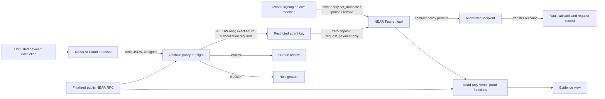

# AgentShield architecture and evidence

## Trust boundaries

The site has no wallet connection: owner actions are signed on the owner's own machine, as the 3 Nov renewal was. On 2026-11-04, 24 real NEAR AI Cloud completions (`z-ai/glm-5.3-flash`) were recorded with signatures that recover to the attested model key; the Intel quote is not verified, and the 180-token limit cut off 22 of 24 replies, which the preflight blocked. So the model-to-preflight edge ran for real and failed closed. On 2026-11-04 a second run (22 completions, 1,024-token limit, `z-ai/glm-5.3-flash`) returned complete answers: the model ignored the injected note, 11 of 19 red-team attacks returned the original payment, 4 returned empty fields, 4 ran out of tokens, none proposed the attacker's account or amount, and 0 escaped. NEAR AI's official verifier passed the Intel TDX and NVIDIA GPU attestation for the signing key; image provenance and TLS binding were not checked. No public inference endpoint exists. The deployed site only reads public RPC (archival nodes for transactions older than about 2.5 days); no signing credential is on Vercel. The restricted function-call key is limited to the vault's `request_payment` method, has a finite gas allowance, and cannot attach deposit. The vault still checks agent identity, allowlist, caps, budgets, expiry, nonce, and revocation. Its callback records settlement after the transfer outcome. A key restriction is a second boundary, not a substitute for contract checks.

## Evidence ladder

| Claim | Required evidence | Current state |
| --- | --- | --- |
| Simulator decision | Deterministic local run | Seven local simulator tests pass; **simulation only** |
| Offchain AI preflight | Genuine model response plus finalized policy read | Mocked AI tests pass; read-only ALLOW/WARN/BLOCK policy check passed; Run 1: 24 signed replies, 22 cut off and blocked. Run 2: 22 signed complete replies, model resisted the demo injection, 0 of 20 red-team cases escaped |
| Contract rejection | Finalized signed call, contract rejection, zero payout receipts | Three public Testnet transactions independently checked |
| Authorized call | Finalized `request_payment` and decision log | One public Testnet transaction independently checked |
| Completed settlement | Exact successful recipient transfer receipt, callback log, `SETTLED` request record | One public Testnet transaction independently checked |
| Live revocation | Separate approved owner revoke and post-revoke agent probe | **Not yet on Testnet; isolated experiment stopped.** NEAR Sandbox test `revocation prevents new payments after settlement` passes against `deployment/agentshield_vault.wasm` |

## Public Testnet references

| Event | Transaction / record | What to inspect |
| --- | --- | --- |
| Vault deployment | [`7K4729…y2dJ`](https://testnet.nearblocks.io/txns/7K4729h6zNHjuXJcGRT9e6HHGxCrUnzFAZ3AnQpfy2dJ) | Create, fund, deploy, initialize; code hash `2KHm9Waz7fQfQ2A1MWmHhVSwx7o7sm8p1KXBTVyggCqN` |
| Restricted key | [`3faZ6…5CaP`](https://testnet.nearblocks.io/txns/3faZ6WmFDgbM8KUCRnbDLztbYSysKwNGdoq83jy95CaP) | Receiver vault, sole method `request_payment`, finite allowance |
| Original mandate | [`GLhrrb…xbG7`](https://testnet.nearblocks.io/txns/GLhrrbxzn93YVKhq6JAxogNW27jf19XqfkfqAJdmxbG7) | Version 1, one agent, one recipient, .01/.02/.05 caps |
| Mandate renewal | [`EuUUbL…vJXw`](https://testnet.nearblocks.io/txns/EuUUbLWvPUVVB2q7AiEVGe54giZaarzBy2hikX74vJXw) | Version 2, same agent, recipient and caps, expiry 2026-11-30 00:00 UTC |
| Settled payment | [`3buDvB…53jm`](https://testnet.nearblocks.io/txns/3buDvBXKDHcCe9VBNtLSSp4H7LLjLfGk7K4XT2jh53jm) | .005 test NEAR, version 1, zero deposit, restricted signer |
| Recipient transfer | `76hE3jsBgdCi8BCBZakcwEMri9Ut7JVu2gDWf3rxK2dS` | Successful receipt within payment transaction; callback `SETTLED` |
| Per-payment cap | [`FEfj7K…L8A`](https://testnet.nearblocks.io/txns/FEfj7KyY5Cr7NTrhDZdXt8Hi1rQqqMwznvK1KhL1ZL8A) | `PER_PAYMENT_LIMIT`; zero vault transfer receipts |
| Unauthorized recipient | [`GvMLEq…gDX9`](https://testnet.nearblocks.io/txns/GvMLEqPTLZfnN4cTVVBS6mKghD7LuTpXgH7ZSAQvgDX9) | `RECIPIENT_NOT_ALLOWED`; zero vault transfer receipts |
| Replay | [`8ktDr3…yjY`](https://testnet.nearblocks.io/txns/8ktDr3AFxE8kVQP1KNkvGBY44oMWWvRCY6tXUqWyvyjY) | `REPLAY`; zero vault transfer receipts |

The explorer blocked automated HEAD requests with HTTP 403 on 2026-11-02, so its page availability is not claimed. The [production payment proof](https://agentshield-lab.vercel.app/api/testnet/proof) and [rejection gallery](https://agentshield-lab.vercel.app/api/testnet/gallery) returned PASS against public RPC. The local verifier scripts recheck final execution, exact actions, receipts and contract records without relying on explorer rendering. Historical payment proof remains tied to mandate version 1 after any later renewal.

**Source to bytecode:** `work/reproduce-vault-wasm.ps1` rebuilds `contracts/vault` with Rust 1.96.0 on Windows and gets the same 324,708-byte WASM (SHA-256 `138b17e7…be09`) that is deployed. CI runs it on every push.
