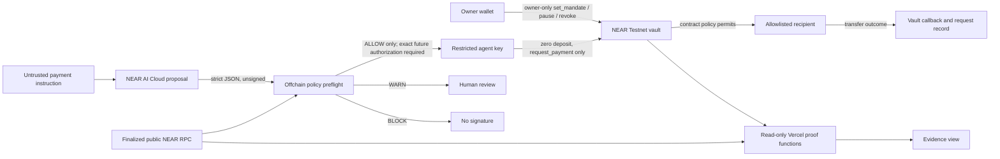

# AgentShield architecture and evidence

## Trust boundaries

The live owner wallet has **not** been verified through browser sign-in. The NEAR AI call has returned HTTP 402, so the model-to-preflight edge is implemented and mocked but **not** live-verified. No public inference endpoint exists. The deployed site only reads public RPC; no signing credential is on Vercel. The restricted function-call key is limited to the vault's `request_payment` method, has a finite gas allowance, and cannot attach deposit. The vault still checks agent identity, allowlist, caps, budgets, expiry, nonce, and revocation. Its callback records settlement after the transfer outcome. A key restriction is a second boundary, not a substitute for contract checks.

## Evidence ladder

| Claim | Required evidence | Current state |
| --- | --- | --- |
| Simulator decision | Deterministic local run | Seven local simulator tests pass; **simulation only** |
| Offchain AI preflight | Genuine model response plus finalized policy read | Mocked AI tests 5/5; read-only ALLOW/WARN/BLOCK policy check passed; **genuine model response blocked by HTTP 402** |
| Contract rejection | Finalized signed call, contract rejection, zero payout receipts | Three public Testnet transactions independently checked |
| Authorized call | Finalized `request_payment` and decision log | One public Testnet transaction independently checked |
| Completed settlement | Exact successful recipient transfer receipt, callback log, `SETTLED` request record | One public Testnet transaction independently checked |
| Live revocation | Separate approved owner revoke and post-revoke agent probe | **Not yet on Testnet; isolated experiment stopped.** NEAR Sandbox test `revocation prevents new payments after settlement` passes against `deployment/agentshield_vault.wasm` |

## Public Testnet references

| Event | Transaction / record | What to inspect |
| --- | --- | --- |
| Vault deployment | [`7K4729…y2dJ`](https://testnet.nearblocks.io/txns/7K4729h6zNHjuXJcGRT9e6HHGxCrUnzFAZ3AnQpfy2dJ) | Create, fund, deploy, initialize; code hash `2KHm9Waz7fQfQ2A1MWmHhVSwx7o7sm8p1KXBTVyggCqN` |
| Restricted key | [`3faZ6…5CaP`](https://testnet.nearblocks.io/txns/3faZ6WmFDgbM8KUCRnbDLztbYSysKwNGdoq83jy95CaP) | Receiver vault, sole method `request_payment`, finite allowance |
| Original mandate | [`GLhrrb…xbG7`](https://testnet.nearblocks.io/txns/GLhrrbxzn93YVKhq6JAxogNW27jf19XqfkfqAJdmxbG7) | Version 1, one agent, one recipient, .01/.02/.05 caps |
| Mandate renewal | [`EuUUbL…vJXw`](https://testnet.nearblocks.io/txns/EuUUbLWvPUVVB2q7AiEVGe54giZaarzBy2hikX74vJXw) | Version 2, same agent, recipient and caps, expiry 2026-11-30 00:00 UTC |
| Settled payment | [`3buDvB…53jm`](https://testnet.nearblocks.io/txns/3buDvBXKDHcCe9VBNtLSSp4H7LLjLfGk7K4XT2jh53jm) | .005 test NEAR, version 1, zero deposit, restricted signer |
| Recipient transfer | `76hE3jsBgdCi8BCBZakcwEMri9Ut7JVu2gDWf3rxK2dS` | Successful receipt within payment transaction; callback `SETTLED` |
| Per-payment cap | [`FEfj7K…L8A`](https://testnet.nearblocks.io/txns/FEfj7KyY5Cr7NTrhDZdXt8Hi1rQqqMwznvK1KhL1ZL8A) | `PER_PAYMENT_LIMIT`; zero vault transfer receipts |
| Unauthorized recipient | [`GvMLEq…gDX9`](https://testnet.nearblocks.io/txns/GvMLEqPTLZfnN4cTVVBS6mKghD7LuTpXgH7ZSAQvgDX9) | `RECIPIENT_NOT_ALLOWED`; zero vault transfer receipts |
| Replay | [`8ktDr3…yjY`](https://testnet.nearblocks.io/txns/8ktDr3AFxE8kVQP1KNkvGBY44oMWWvRCY6tXUqWyvyjY) | `REPLAY`; zero vault transfer receipts |

The explorer blocked automated HEAD requests with HTTP 403 on 2026-11-02, so its page availability is not claimed. The [production payment proof](https://agentshield-lab.vercel.app/api/testnet/proof) and [rejection gallery](https://agentshield-lab.vercel.app/api/testnet/gallery) returned PASS against public RPC. The local verifier scripts recheck final execution, exact actions, receipts and contract records without relying on explorer rendering. Historical payment proof remains tied to mandate version 1 after any later renewal.

**Source to bytecode:** `work/reproduce-vault-wasm.ps1` rebuilds `contracts/vault` with Rust 1.96.0 on Windows and gets the same 324,708-byte WASM (SHA-256 `138b17e7…be09`) that is deployed. CI runs it on every push.
