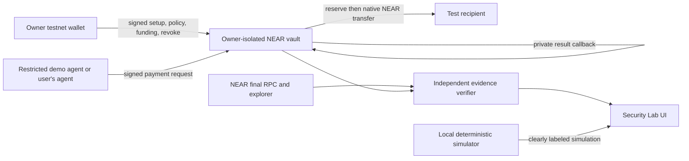

# AgentShield — verifiable Security Lab implementation plan

> **Historical note, written 2026-10-27.** Kept for the record; it describes plans or checks from before the vault was deployed. Current, verified state: the vault is live on NEAR Testnet with two settled payments (one made through the MCP server) and seven contract rejections. See [README.md](../README.md) and [docs/ARCHITECTURE_AND_EVIDENCE.md](../docs/ARCHITECTURE_AND_EVIDENCE.md).

**Prepared:** 2026-10-27 (Africa/Lagos). **Status:** PLAN ONLY; no contract, wallet integration, simulation, transaction verifier, testnet deployment, or live security test has been implemented by this plan.

## Decision and current baseline

The [official event page](https://nearhackathon.com/) says to build during the hackathon, and the [official HACKATHON.md](https://nearhackathon.com/HACKATHON.md) dates development from **2026-11-01 00:00 UTC** through **2026-11-14 23:59 UTC**. Neither specifies whether pre-event source or artwork may be reused. The user's pasted **“AGENTSHIELD — THE VERIFIABLE SECURITY LAB”** directive, section 0, explicitly says to prepare architecture and a detailed plan without potentially ineligible development while this is unresolved. Therefore the implementation gate stays closed until the event starts or an organizer explicitly clarifies earlier development and reuse. Existing UI work must be disclosed as pre-event work if later used; do not describe it as built during the event.

The current workspace is a projectless directory, not a Git repository. `outputs/agentshield-ui/` is a static, branded HTML/CSS/JS preview with a local browser mandate draft, empty evidence, disabled owner actions, and a read-only NEAR testnet Lab account check. The local preview server's RPC proxy cannot sign. Read-only mainnet and testnet connectivity was checked in the existing reports. There is **no** vault, wallet connection, funded test account, submitted payment, security simulation, receipt verifier, or completed contract test. Preserve the visual language in `outputs/agentshield-ui/BRAND.md` and the user-approved merged guardian/statue/robotic-hand art, subject to the reuse ruling.

## Product boundary and architecture

**First executable proof:** one owner, one configured agent, native NEAR on **testnet**, allowlisted recipients, and a controlled vault that holds only the owner's test funds. The agent proposes a payment; the contract alone decides whether controlled funds move. No generic wallet delegation, arbitrary contract calls, Intents, tokens, mainnet payout, or private-key input in the browser.

**Isolation:** target one owner-controlled vault account per owner. The owner must retain full account/upgrade authority; any setup helper or factory must leave no administrator key that can redirect funds or silently replace code. Verify deployed account access keys and code hash. If automated per-owner provisioning cannot meet this property with the selected wallet, keep live setup explicitly manual/advanced while designing a safe flow; do not silently substitute a common public vault. A read-only genuine evidence gallery can serve walletless judges.

**Demo agent:** a server-side testnet signer may submit narrowly scoped requests only after an owner has approved and finalized the vault policy. Prefer a dedicated agent identity or receiver-restricted function-call key per vault. Never ship a credential to the frontend. Rate-limit by session and vault, enforce testnet-only receiver/method/gas limits and a small global funding budget, and allow owners to revoke it onchain. A service response is a request status, never a payment verdict. The service must not have an owner key or any alternative vault payout capability. Validate this architecture before opening a public live demo.

**Trust boundaries:** the frontend and optional service can guide, simulate, submit, and read; they cannot authorize spending. Owner actions require a wallet signature with the exact network, receiver, method, and deposit shown. Contract policy and chain state are authoritative; a local cache is not. Mainnet and testnet configuration, RPC URLs, account IDs, and explorer links must be visibly separated.

## Contract interface and state machine

Use Rust with a pinned NEAR SDK/toolchain after the eligibility gate. Keep all monetary values as decimal integer yoctoNEAR strings at the external interface and checked integers internally. Define a versioned mandate with owner ID, allowed agent account, allowed recipients, per-payment cap, cumulative cap, UTC calendar-day cap, expiration, active/revoked state, policy version, confirmed spend, pending reservations, and a unique vault domain. Make UTC-day behavior explicit; do not call it a rolling 24-hour cap.

Proposed methods, to refine with SDK constraints before implementation:

| Method | Caller | Result and invariant |
| --- | --- | --- |
| `initialize(owner, domain)` | deployment/init authority | One-time owner binding and testnet domain. |
| `fund()` | owner predecessor, payable | Accept an exact, wallet-approved testnet deposit and expose the resulting vault balance. |
| `set_mandate(policy)` / `pause()` / `revoke()` | owner predecessor | Validate all fields, increment version, emit durable policy decision. |
| `request_payment(recipient, amount, nonce, expiry, version)` | configured agent predecessor | Compute canonical action hash onchain; either record a durable `REJECTED` policy decision with no transfer promise, or atomically consume nonce, reserve every applicable budget, record `PENDING`, and schedule the exact transfer. |
| `on_transfer_result(authorization_id)` | contract itself | Private callback; settle success or release reserved budget on failure, exactly once. A failed payout does not restore nonce. |
| `get_mandate()` / `get_request(id)` / `get_totals()` | read-only | Return versioned policy and decision/accounting data for independent verification. |
| `withdraw_excess(amount)` | owner predecessor | Preserve pending payouts, storage costs, and an operating reserve. |

The action identity includes fixed domain prefix, network, vault ID, owner ID, agent ID, mandate ID and version, recipient, exact amount, nonce, and expiry. Hash a canonical, versioned encoding; the contract must compute it, not trust a client-supplied hash. Reject invalid accounts, zero/overflow amounts, expired requests, wrong caller, wrong domain/version, unlisted recipient, exhausted budgets, and reused nonce. Reserve spend **before** scheduling the asynchronous transfer, so two requests racing for the last allowance cannot both pass. NEAR cross-contract actions are asynchronous and a failed downstream action does not undo the original authorization; design the callback and reconciliation accordingly ([NEAR cross-contract docs](https://docs.near.org/smart-contracts/anatomy/crosscontract)). Revocation blocks newly authorized requests after finality but cannot cancel an already submitted payout.

Use an explicit contract-level `REJECTED` response and durable request record for normal policy violations where practical. Transaction execution success can then coexist with a rejected payment decision. Bound stored history and storage cost, and avoid persistent per-request writes from arbitrary unauthorized callers so rejection evidence cannot become a storage-denial attack. For a method-level failure, verify the actual chain failure; do not rely on logs from reverted execution. The decision record must bind request ID to reason, policy version, amount, recipient, and action hash. Events are supplementary evidence; state and receipts are decisive. Document that owner/upgrade key compromise remains outside the agent-policy guarantee.

## Two lab modes and user flow

**Instant Demo:** first screen asks “Can your AI agent spend money you didn't authorize?” and offers “Put AgentShield to the test.” A deterministic, testable local model lets a visitor edit an example policy, run valid payment, over-cap, wrong-recipient, replay, and revoked-agent cases, then pause/revoke/reset. Every demo result says **SIMULATION — NO ONCHAIN TRANSACTIONS**. Use separate memory/state from live mode and never generate explorer links, chain hashes, or fake balances. The simulation teaches the same decision rules but makes no claim that it proves the contract.

**Live NEAR Testnet:** connect a supported testnet wallet; derive owner ID from the wallet session, never require manual owner ID in the primary flow. Show current network, selected vault and its verified code hash, owner, agent and recipient, policy, funding amount, and every required signature before asking for approval. The primary path should guide a visitor through vault provisioning, conservative funding, policy creation, and the five tests. Advanced setup accepts public account IDs and custom recipients after chain validation. Public judge mode shows genuine prior proofs without wallet setup.

The existing `Lab` view can become the live onboarding surface after the contract and proof path exist. Keep the Gothic monochrome visual system, existing composite art, restored footer items and `built by @magnum inc.`. Provide clear focus states, reduced-motion support, readable mobile layouts, useful loading/timeout/retry feedback, and smooth but nonessential motion in the payment-flow visualization. Never animate a transfer into `CONFIRMED` before verification. Owner controls stay disabled until connected account, deployed vault identity, and relevant onchain state are verified.

## Test runner and proof rules

Run five primary scenarios individually: **01 authorized payment**, **02 per-payment cap violation**, **03 unauthorized recipient**, **04 exact replay**, **05 owner revocation then agent request**. Each panel shows requested action, policy condition, signed account, contract decision, transaction outcome, receipt outcome, accounting delta, and independent proof link. A “Run all” sequence may orchestrate agent requests, but every owner setup/funding/revocation action still requires its own visible wallet approval. Additional cases cover expiry, wrong agent, stale version, cumulative/day caps, boundary amounts, simultaneous requests, failed transfer/callback, and RPC outage.

The verifier queries a documented NEAR testnet RPC with transaction hash **and signer**, waits for final execution, inspects transaction/receipt outcomes and the relevant contract state, and checks recipient balance when a payout is claimed. NEAR's [RPC transaction documentation](https://docs.near.org/api/rpc/transactions) describes final status and receipts. A mere transaction hash, frontend validation, contract `AUTHORIZED` result, or success of the initial function call does **not** prove settlement. For success, require the correct vault/agent/policy/action, successful downstream transfer receipt, expected recipient credit, and final accounting. Balance deltas are corroboration, not causal proof, because a recipient can receive unrelated funds. For rejection, require the request actually reached the vault, a matching durable rejection or verified failure, no payout receipt for that request, and unchanged relevant spend state. If a transfer is pending, a callback is delayed, balances are ambiguous, or RPC sources disagree, show **PENDING** or **INCONCLUSIVE**, never pass.

The evidence explorer stores no invented chain facts. A record includes network, vault and verified code hash, owner/agent/recipient public IDs, mandate/version, request ID/action hash, amount, decision reason, tx hash and signer, finality, transfer receipt, before/after accounting, relevant balance check, timestamp, independent explorer/RPC links, and verifier version. Separate `CLIENT-SIDE VALIDATION — NOT AN ONCHAIN REJECTION` from genuine chain rejection. Publish a read-only gallery only after it contains genuine, reproducible testnet evidence with accounts and hashes that can be independently queried.

## Build order, verification, and release gates

| Phase | Deliverable | Gate to exit |
| --- | --- | --- |
| P0 eligibility and project | Organizer rule or event start recorded; approved project repository; exact toolchain and testnet setup pinned | No pre-event implementation misrepresented; repo creation authorized; prior assets' reuse decision recorded. |
| P1 contract foundation | Rust vault, owner/agent separation, mandate, reservation, nonce, callback, events/state views | Unit and NEAR Sandbox tests pass for owner-only methods, limits, race, replay, revoke, failure release, and pending withdrawal reserve. |
| P2 live chain | Owner-isolated provisioning, wallet integration, limited agent request route, one small authorized testnet payment | Actual deployment/code hash, signed setup/funding, transaction and receipt, recipient credit, accounting reconciled. |
| P3 verifier | Finality-aware independent RPC checks, evidence records and links | Correctly distinguishes authorized, settled, rejected, failed, pending, inconclusive, and client-only validation. |
| P4 interactive lab | Instant Demo, live five-test runner, advanced cases | Simulation and live modes cannot be confused; five live tests show genuine pass/fail evidence. |
| P5 product UX | Guided onboarding, policy playground, dashboard, flow animation, walletless gallery | Mobile, keyboard, focus, reduced-motion, wallet disconnect, errors, and recovery checked. |
| P6 hardening and judging | Threat review, reproducible README, verification report, demo preparation | Fresh independent reproduction and security review; deployment and each public action explicitly authorized. |

Record for every case the exact command/action, environment and contract ID, expected invariant, actual state, tx and receipt references, and result. Sandbox tests must assert contract state and transfer outcomes, not merely returned values. Frontend tests should cover mode labels, wallet/account mismatch, data parsing, and conservative error states. A live test is `PASS` only with finalized evidence; mark unrun cases `PENDING` and failed invariants `FAIL`. A security review must probe compromised agent/service behavior, cross-owner isolation, upgrade keys, nonce races, failed payouts, storage/gas reserve, and RPC uncertainty. This is security engineering, not an audit claim.

## Decisions and approvals needed later

1. Obtain organizer clarification on pre-event frontend/artwork reuse, or begin new submission-specific implementation at/after **2026-11-01 00:00 UTC** with the eligibility assumption recorded.
2. Obtain the user's explicit approval for a repository under `0xNexuz`; no repository exists in this workspace. Record exact location and Git state at creation.
3. Before any testnet deployment or value-moving test, present the exact owner/agent/vault accounts, contract code hash, methods, transaction sequence, and small testnet funding ceiling for approval. Never request seed phrases or private keys.
4. Public hosting, repository publication/push, demo posting, mainnet activity, and final submission are separate consequential actions requiring explicit authorization. The official HACKATHON.md requires the human's exact submission-payload confirmation.

**Next implementation step once the gate opens:** create the approved repository, pin toolchain and NEAR dependencies, write the vault and Sandbox tests, then integrate wallet and lab around a verified contract. Do not label the current read-only RPC preview a live security test.
