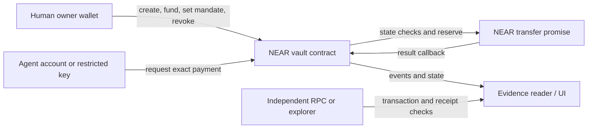

# AgentShield — proposed build specification

> **Historical note, written before the event.** Kept for the record; it describes plans or checks from before the vault was deployed. Current, verified state: the vault is live on NEAR Testnet with two settled payments (one made through the MCP server) and seven contract rejections. See [README.md](../README.md) and [docs/ARCHITECTURE_AND_EVIDENCE.md](../docs/ARCHITECTURE_AND_EVIDENCE.md).

**Status:** PROPOSED / PLANNED. A pre-event standalone frontend design preview exists; no contract, wallet integration, production application or deployment exists in this workspace.

## Product and proof

**User:** a developer who runs a payment-capable AI agent. **Job:** let the agent make small NEAR testnet payments without access to the owner's unrestricted wallet. **Core proof:** the same contract that holds the controlled funds permits a valid payment and rejects an over-limit request, a repeated nonce, a changed action, and a request after revocation.

The agent is an untrusted action proposer. A human owner creates and funds a vault, registers an agent NEAR account, and sets a mandate. The agent's NEAR account signs a contract call. The vault checks `predecessor_account_id`, mandate version and status, domain/network, recipient allowlist, exact integer amount, expiry, nonce uniqueness and budget; then it commits authorization and schedules a NEAR transfer. The agent receives no vault key. An optional function-call key on the agent account can narrow it to the vault's request method.

## Security boundaries and state

- **NEAR contract is the final enforcement and custody boundary.** UI and API may format requests but cannot authorize payouts. The owner key only changes mandates and funds/withdraws owned balances. The agent key only submits requests. A compromised frontend or backend must not be able to exceed contract policy.
- MVP asset/network is **native NEAR on testnet only**. No generic contract calls, token approvals, cross-chain transactions, USD-valued caps, or unrestricted signing. Network and vault account ID are included in the domain-separated action hash. Amounts are integer yoctoNEAR strings; reject zero, overflow, malformed account IDs and deadlines.
- Proposed canonical action fields, in a versioned Borsh struct with fixed field order: `domain`, `vault_account_id`, `network`, `owner_account_id`, `agent_account_id`, `mandate_id`, `mandate_version`, `recipient_id`, `amount_yocto`, `nonce`, `expires_at_ns`. Hash is SHA-256 of the encoded struct with a fixed `AGENTSHIELD_ACTION_V1` prefix. The contract computes and stores this hash for evidence and binds it to the exact transfer it constructs. A caller-computed hash alone is **not** an approval or tamper defense, because a compromised caller can recompute it. An owner exception approval, if added later, must authorize this exact hash once with expiry.
- Mandate v1: active flag, expiry, recipient allowlist, per-payment cap, cumulative cap, UTC-day cap, and policy version. The UTC-day cap is a calendar-day window, explicitly shown as such; a true rolling 24-hour window is later scope. Effective spending is confirmed spend **plus pending reservations**. Payout reservation and nonce consumption happen atomically before the transfer promise. Failed transfer releases the reservation in a private callback but **does not free the nonce**. Successful transfer settles the reservation. No retry reuses the old nonce; a new request must pass policy again.
- Callback may only be called by the contract and must be idempotent by authorization ID. Logs and database rows are not authoritative. A state change during an in-flight transfer does not cancel that transfer. Revocation blocks new requests after the revocation transaction is finalized; already submitted transfers may settle.
- Owner withdrawals must preserve pending payouts, contract storage costs and operating reserve. A contract upgrade, administrative key or alternative payout method can bypass guarantees unless explicitly governed and disclosed. MVP must inspect deploy-account keys and keep upgrade authority with the owner; no claim of immutable security.
- State machine: `PROPOSED → REJECTED` or `AUTHORIZED → SUBMITTED → CONFIRMED | FAILED`. `PENDING_CONFIRMATION` is shown when chain evidence is incomplete. Contract outcome plus independent RPC receipt and balance check is required before the UI says confirmed. Reconciliation tolerates delayed callbacks and RPC outages.

## MVP acceptance criteria

1. Owner can register one agent, configure an allowlisted recipient, per-payment, cumulative and UTC-day budgets, fund the vault, pause/revoke, and inspect policy version on NEAR testnet.
2. Valid agent request moves a small amount to an allowlisted recipient; sandbox and testnet evidence show contract decision, transaction result and recipient balance change.
3. Actual vault rejects over-limit, unknown recipient, expired mandate, wrong agent, duplicate nonce and post-revocation request. A replayed authorization ID with altered recipient, amount or domain cannot change the already constructed transfer or trigger another one. No controlled funds move for rejected cases.
4. Two requests competing for the last budget cannot both succeed. A failed transfer does not permanently consume budget or allow replay. Boundary amounts use integers.
5. UI explains each status and policy decision, links to independently checkable evidence, never shows fabricated funds or transactions, and remains usable by keyboard on mobile and desktop.

## Threat model and limits

| Threat | Planned control | Verification |
|---|---|---|
| Prompt injection / malicious agent | Agent only proposes, contract enforces all rules | Injection-inspired request exceeding cap rejected |
| Stolen agent key | Recipient and amount caps, expiry, owner pause | Stolen-key simulation cannot escape mandate |
| Replay or altered authorization | Contract nonce set; transfer constructed from checked fields; action hash retained as evidence | Exact replay and attempted change after authorization fail |
| Budget race | Atomic onchain reservation before promise | Concurrent last-budget test |
| Failed or delayed payout | Callback, reserved budget, reconciliation | Failing recipient/path and delayed result tests |
| Owner/upgrade compromise | Owner remains trusted; disclose upgrade authority | Verify deployed access keys and code hash |
| Bad RPC or UI | Independent receipt/balance checks, unknown status | RPC outage/error states, no false confirmation |

## Product experience

Dark-first, restrained financial security interface. The primary screen answers: **who can spend, how much remains, what was attempted, and what really settled**. Proposed surfaces: landing; wallet onboarding; agent registration; policy editor; agent overview; request detail; activity/evidence; emergency controls. Use explicit labels `Authorized` and `Confirmed` with different colors/text. Place pause/revoke beside the active mandate with a clear in-flight warning. Default to empty states with setup actions, not sample balances. Forms validate exact units and account IDs inline. Keyboard focus, contrast, reduced motion, readable mobile tables and actionable error messages are required. Design tokens and stack-specific UI decisions are deferred until a real application repository exists.

## Exclusions and expansion gates

- Chain Signatures, Shade Agents, Intents, swaps, multi-chain, stablecoin, arbitrary contract calls, manual exception approvals, rolling windows and reusable SDK are P2 after the first payment path is verified.
- A real Intents path is a **separate mainnet-funded scope** because [official Intents FAQ](https://docs.near.org/chain-abstraction/intents/faq) reports no testnet deployment.
- “Production-minded” means sound boundaries and honest evidence; this specification alone does not constitute an audit or production assurance.
